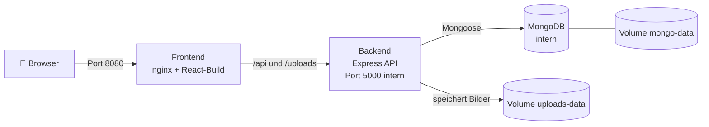

# 🍽️ Foodly – Essensplaner und Einkaufsliste

**Foodly** ist eine Full-Stack-Webanwendung. Nutzer planen ihre Mahlzeiten für eine ganze Woche, die App erstellt daraus automatisch **eine Einkaufsliste, sortiert nach Supermarkt-Abteilungen**, und die Bestellung kann (als Demo) abgeschickt werden. Die Oberfläche startet standardmäßig auf **Englisch**; über einen Button in der Navigationsleiste lässt sie sich auf **Arabisch** umstellen (inklusive vollständiger Spiegelung des Layouts, RTL/LTR).

> Hinweis: Diese Dokumentation gibt es auf Deutsch, die Benutzeroberfläche der App selbst unterstützt Englisch und Arabisch.

---

## 1) Projektidee in Kürze

1. Nutzer registrieren sich und durchsuchen Rezepte (Filter nach Ernährungsform und Allergenen).
2. Sie fügen Rezepte zu einem **Wochenplan** hinzu (7 Tage × Frühstück / Mittag / Abendessen / Snack).
3. Das System fasst die Zutaten aller Rezepte zusammen, führt doppelte Zutaten zusammen und sortiert sie in eine **Einkaufsliste** nach Kategorie (Gemüse, Milchprodukte, Fleisch ...).
4. Sie können eine **Bestellung (Demo-Checkout)** abschließen und ihre Bestellungen verfolgen.
5. Sie können **eigene Rezepte einreichen**. Diese erscheinen für alle erst, nachdem ein Administrator sie freigegeben hat.
6. Sie können Rezepte **bewerten** (1 bis 5 Sterne) und einen **Kommentar** schreiben, den alle Besucher sehen.

---

## 2) Verwendete Technologien

| Schicht | Technologie | Zweck |
|---|---|---|
| Frontend | **React 19 + Vite** | schnelle, komponentenbasierte Oberfläche |
| Styling | **Tailwind CSS** | responsives Design |
| Navigation | **React Router** | mehrere Seiten ohne Neuladen |
| HTTP-Client | **Axios** | Kommunikation mit der API |
| Backend | **Node.js + Express** | REST-API |
| Datenbank | **MongoDB + Mongoose** | Nutzer, Rezepte, Pläne, Bestellungen, Bewertungen |
| Sicherheit | **JWT + bcryptjs** | sicherer Login, Passwort-Hashing |
| Bild-Upload | **Multer** | Rezeptbilder (nur JPEG / PNG / WebP) |
| Tests | **node:test** (in Node enthalten) | Integrationstests der API |
| Betrieb | **Docker + Docker Compose, nginx** | einfacher, reproduzierbarer Start |

---

## 3) Architektur

**Mit Docker (empfohlen):** Der Browser spricht nur mit nginx. nginx liefert die Webseite aus und leitet `/api` und `/uploads` an das Backend weiter. Dadurch gibt es keine CORS-Probleme, und Datenbank sowie API sind von außen nicht erreichbar.



**Manuell (Entwicklung ohne Docker):** Vite-Server auf Port 5173, API auf Port 5000.

- Das Frontend greift nie direkt auf die Datenbank zu, alles läuft über die API.
- Nach dem Login liefert der Server ein **JWT-Token** (7 Tage gültig), das das Frontend bei jeder Anfrage im Header mitsendet.

---

## 4) Ordnerstruktur

```
foodly1/
├── backend/
│   ├── compose.yaml          ← startet alle Dienste (MongoDB + Backend + Frontend)
│   ├── compose.dev.yaml      ← Ergänzungen für den Entwicklungsmodus (Hot Reload)
│   ├── .env.example          ← Vorlage für die geheimen Einstellungen
│   ├── server.js             ← Einstiegspunkt, Routen, Health-Check
│   ├── config/db.js          ← MongoDB-Verbindung (mit Wiederholungsversuchen)
│   ├── models/               ← Datenmodelle (User, Recipe, MealPlan, Order, Rating)
│   ├── routes/               ← API-Routen (auth, recipes, mealplan, grocery, orders, ratings, submissions, uploads, admin)
│   ├── middleware/           ← auth.js (Login-Prüfung), admin.js (Admin-Rechte)
│   ├── utils/                ← groceryAggregator.js (Zutaten zusammenführen), recipeValidation.js
│   ├── data/seedRecipes.js   ← vordefinierte Rezepte
│   ├── scripts/              ← Hilfsskripte (init-db, make-admin, migrate ...)
│   ├── tests/                ← automatische Tests
│   ├── Dockerfile            ← Backend-Image (Multi-Stage)
│   └── docker-entrypoint.sh  ← wartet auf die DB, bereitet sie vor, startet den Server
└── frontend/
    ├── src/
    │   ├── pages/            ← Seiten (Landing, Recipes, Planner, Grocery, Checkout, Orders, Admin ...)
    │   ├── components/       ← wiederverwendbare Komponenten (Navbar, RecipeCard, RatingBox ...)
    │   ├── api/client.js     ← alle API-Aufrufe an einer Stelle
    │   ├── context/          ← AuthContext (eingeloggter Nutzer)
    │   ├── i18n/             ← Übersetzungen (translations.js + LanguageContext)
    │   └── utils/            ← Hilfsfunktionen (Datum, Demo-Preise)
    ├── public/               ← Bilder und Video
    ├── Dockerfile            ← baut die Seite und liefert sie über nginx aus
    └── nginx.conf            ← Auslieferung + Weiterleitung von /api und /uploads
```

---

## 5) Datenbank (Collections)

| Collection | Wichtigste Felder |
|---|---|
| **User** | name, email, password (gehasht), role (`user` / `admin`) |
| **Recipe** | title, description, ingredients, steps, calories, dietTags, allergens, difficulty, status (`pending` / `approved` / `rejected`), ratingAverage, ratingCount |
| **MealPlan** | userId, weekStart, meals[ {dayIndex 0–6, mealType, recipe, servings} ] |
| **Order** | userId, items, subtotal, deliveryFee, total, deliveryMethod, paymentMethod, status (`placed` / `processing` / `completed` / `cancelled`) |
| **Rating** | recipe, user, value (1–5), comment (optional) – **pro Nutzer und Rezept nur eine Bewertung** (durch einen eindeutigen Index garantiert) |

---

## 6) API-Übersicht

> 🔒 = Login erforderlich &nbsp;|&nbsp; 👑 = nur für Administratoren

| Methode | Pfad | Funktion |
|---|---|---|
| POST | `/api/auth/register` · `/api/auth/login` | Registrierung / Login |
| GET 🔒 | `/api/auth/me` | Daten des aktuellen Nutzers |
| GET | `/api/recipes` · `/api/recipes/:id` | Rezepte anzeigen (nur freigegebene) |
| POST/PUT/DELETE 👑 | `/api/recipes` ... | Rezepte verwalten |
| GET 🔒 | `/api/mealplans/:weekStart` | Wochenplan abrufen |
| POST 🔒 | `/api/mealplans/:weekStart/meals` | Mahlzeit in einen Slot (Tag + Mahlzeittyp) eintragen |
| DELETE 🔒 | `/api/mealplans/:weekStart/meals/:slotId` | Mahlzeit entfernen |
| DELETE 🔒 | `/api/mealplans/:weekStart` | ganze Woche leeren |
| GET 🔒 | `/api/grocery-list/:weekStart` | zusammengeführte Einkaufsliste |
| POST/GET 🔒 | `/api/orders` · `/api/orders/:id` | Bestellung erstellen / eigene Bestellungen ansehen |
| GET/PUT 🔒 | `/api/recipes/:recipeId/rating` | eigene Bewertung und Kommentar lesen / speichern (`value` 1–5, `comment` optional, max. 1000 Zeichen) |
| GET | `/api/recipes/:recipeId/rating/reviews` | öffentliche Kommentarliste (nur Vorname des Autors) |
| GET | `/api/health` | Zustand von Server und Datenbank (wird von Docker genutzt) |
| POST 🔒 | `/api/submissions` · GET `/api/submissions/mine` | Rezept zur Prüfung einreichen / eigene Rezepte |
| POST 🔒 | `/api/uploads/recipe-image` | Rezeptbild hochladen |
| GET/PATCH 👑 | `/api/admin/recipes` ... `/api/admin/orders` ... | Rezepte freigeben/ablehnen, Bestellstatus ändern |

---

## 7) Sicherheit (Punkte für die Präsentation)

- **Passwörter** werden mit bcrypt gehasht und nie im Klartext gespeichert.
- **JWT** identifiziert Nutzer, `middleware/auth.js` schützt private Routen.
- **Admin-Rechte** werden bei jeder Anfrage im Server geprüft (`middleware/admin.js`), nicht nur im Frontend.
- **Eingabeprüfung** im Server (E-Mail, Passwortlänge, Bewertungswerte, Rezeptdaten, Kommentarlänge).
- **Bild-Upload:** nur JPEG/PNG/WebP, mit Größenlimit, der Dateiname wird vom Server vergeben.
- **Kommentare** werden von React automatisch maskiert, es kann kein HTML eingeschleust werden.
- **Bezahlung ist komplett simuliert:** Kartennummern werden nie gespeichert oder an den Server gesendet.
- **Docker:** Container laufen ohne Root-Rechte, Geheimnisse stehen nur in der `.env` (nicht im Image und nicht im Git), die Datenbank ist von außen nicht erreichbar.

---

## 8) Zwei Sprachen (Englisch / Arabisch)

- Alle Texte stehen zentral in `frontend/src/i18n/translations.js`.
- Der Sprachumschalter befindet sich in der Navigationsleiste, die gewählte Sprache wird im Browser gespeichert.
- Bei Arabisch wird das Layout automatisch auf **RTL** gespiegelt.
- Standardsprache: **Englisch**. Alle Seiten unterstützen beide Sprachen.

---

## 9) Starten des Projekts

### Variante 1 (am einfachsten): Docker Compose 🐳

Voraussetzung: [Docker Desktop](https://www.docker.com/products/docker-desktop/) (oder Docker + Compose v2). Node.js und MongoDB müssen **nicht** installiert werden.

```bash
cd backend
cp .env.example .env        # Windows PowerShell: copy .env.example .env
```
Die Docker-Dateien (`compose.yaml` und `.env.example`) liegen im Ordner `backend`, alle `docker compose`-Befehle werden dort ausgeführt. Öffne die Datei `.env` und fülle nur zwei Werte aus: `MONGO_PASSWORD` (nur Buchstaben und Ziffern) und `JWT_SECRET` (langer Zufallstext, z. B. mit `openssl rand -hex 48`). Danach:

```bash
docker compose up --build
```
Öffne **http://localhost:8080**. Beim ersten Start legt das System die Indizes an und lädt die Beispielrezepte automatisch.

| Befehl | Wirkung |
|---|---|
| `docker compose up --build -d` | im Hintergrund starten |
| `docker compose logs -f` | Logs anzeigen (`logs -f backend` für einen einzelnen Dienst) |
| `docker compose ps` | Status der Dienste (zeigt „healthy“, wenn bereit) |
| `docker compose stop` | anhalten (Daten bleiben erhalten) |
| `docker compose down` | Container entfernen – **Daten bleiben** in den Volumes |
| `docker compose up --build` | Images nach Code-Änderungen neu bauen |
| `docker compose down -v` | ⚠️ löscht zusätzlich Datenbank und hochgeladene Bilder (kompletter Reset) |
| `docker compose exec backend node scripts/make-admin.js du@mail.com` | einen registrierten Nutzer zum Admin machen |

**So funktioniert es (zum Erklären):**
- Drei Dienste: `mongo` (Datenbank) ← `backend` (API) ← `frontend` (nginx).
- Jeder Dienst startet erst, wenn der vorherige per **Health-Check** „healthy“ ist. Ist MongoDB noch nicht bereit, versucht das Backend die Verbindung automatisch erneut (bis zu 20 Mal).
- Nach außen offen ist nur die Webseite (Port 8080). Datenbank und API sind nicht direkt erreichbar.
- Daten liegen in Volumes: `mongo-data` (Datenbank) und `uploads-data` (hochgeladene Bilder). Sie gehen beim Neubauen nicht verloren.
- Bei jedem Start läuft `scripts/init-db.js`: legt Indizes an, führt die Migration aus (sicher, löscht nichts) und lädt die Beispielrezepte **nur, wenn die Datenbank leer ist**.
- Die Container laufen ohne Root-Rechte. Geheimnisse kommen nur aus der `.env` (nicht im Image, ausgeschlossen durch `.dockerignore` und `.gitignore`).

**Entwicklungsmodus (Code ändern, sofort sehen):**
```bash
docker compose -f compose.yaml -f compose.dev.yaml up --build   # im Ordner backend
```
Frontend: http://localhost:5173, API: http://localhost:5000 (benötigt Docker Compose ab Version 2.24).

### Variante 2: ohne Docker (manuell)

**Voraussetzungen:** Node.js 18 oder neuer + MongoDB.

#### a) Backend
```bash
cd backend
npm install
```
Kopiere `backend/.env.example` nach `backend/.env`, trage `JWT_SECRET` ein und entferne das `#` vor der Zeile `MONGO_URI` (Abschnitt „WITHOUT DOCKER“ in der Datei):
```env
MONGO_URI=mongodb://127.0.0.1:27017/foodly
JWT_SECRET=hier_einen_langen_geheimen_text_eintragen
```
Danach:
```bash
npm run seed        # Beispielrezepte laden (einmalig)
npm run dev         # Server auf http://localhost:5000
```

#### b) Frontend
```bash
cd frontend
npm install
npm run dev         # läuft auf http://localhost:5173
```
> Liegt der Server unter einer anderen Adresse, lege `frontend/.env` an mit: `VITE_API_URL=http://localhost:5000/api`

#### c) Admin-Konto erstellen
Registriere zuerst ein normales Konto auf der Webseite, dann:
```bash
cd backend
npm run make-admin -- deine@email.com
```

#### d) Tests
```bash
cd backend
# Der Name der Testdatenbank muss das Wort "test" enthalten (Schutz vor dem Löschen echter Daten)
MONGO_URI_TEST=mongodb://127.0.0.1:27017/foodly_test npm test
```

---

## 10) Häufige Probleme

| Problem | Ursache und Lösung |
|---|---|
| Meldung „Could not load your meal plan. Is the server running?“ | Server gestoppt, MongoDB nicht verbunden oder nicht eingeloggt. Backend starten (`npm run dev`) und `MONGO_URI` prüfen. |
| `MongoDB connection failed` | MongoDB läuft nicht oder `MONGO_URI` ist falsch (in Docker wiederholt das Backend automatisch; siehe `docker compose logs mongo`). |
| `Set MONGO_PASSWORD in .env` bei `docker compose up` | `.env.example` wurde nicht nach `.env` kopiert oder die Werte sind leer. |
| CORS-Fehler | Bei manuellem Start erlaubt der Server `http://localhost:5173` (änderbar über `CORS_ORIGIN`). In Docker gibt es kein CORS-Problem, da alles über eine Adresse läuft. |
| Seite in der „falschen“ Sprache | Die gewählte Sprache wird im Browser gespeichert. Einfach den Sprachbutton in der Navigationsleiste drücken. |

---

## 11) Aktuelle Einschränkungen

- Die Bezahlung ist nur eine **Simulation** (kein echter Zahlungsanbieter), die Preise sind Schätzwerte.
- Hochgeladene Bilder liegen auf der Festplatte des Servers (Ordner `uploads/` bzw. Docker-Volume), nicht in einem Cloud-Speicher.
- Die Docker-Konfiguration ist für Demo und Test gedacht. Für eine Veröffentlichung im Internet sollte HTTPS (z. B. Caddy, Traefik oder der Hosting-Anbieter) vor den Port 8080 geschaltet werden.
