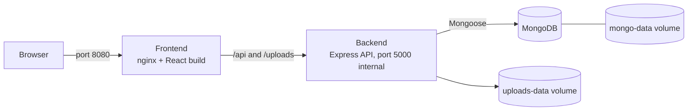

<div dir="rtl">

# 🍽️ Foodly — مخطِّط الوجبات وقائمة التسوق

**Foodly** تطبيق ويب متكامل (Full-Stack) لتخطيط وجبات الأسبوع. تختار وصفات لكل يوم، فيبني التطبيق تلقائيًا **قائمة تسوق مدمجة ومرتبة حسب أقسام السوبرماركت**. يمكنك بعدها إتمام طلب تجريبي، وتقييم الوصفات، وإرسال وصفاتك الخاصة لمراجعة المشرف.

الواجهة متاحة بـ **الإنجليزية والعربية** مع قلب كامل للتخطيط (RTL).

---

## المزايا

- **كتالوج وصفات** مع بحث وفلاتر (أنظمة غذائية، مسببات الحساسية)
- **مخطط أسبوعي**: 7 أيام × فطور / غداء / عشاء / وجبة خفيفة
- **قائمة تسوق ذكية**: دمج المكونات المتكررة وتصنيفها حسب الفئة
- **دفع تجريبي**: توصيل أو استلام، دفع عند الاستلام أو بطاقة (محاكاة فقط، بلا دفع حقيقي)
- **تقييمات وتعليقات**: تقييم واحد من 1 إلى 5 نجوم لكل مستخدم لكل وصفة
- **إرسال وصفات**: يرسل المستخدمون وصفاتهم، وتظهر للجميع فقط بعد موافقة المشرف
- **لوحة المشرف**: قبول/رفض الوصفات (مع ذكر السبب) وتغيير حالة الطلبات
- **واجهة ثنائية اللغة**: زر تبديل في شريط التنقل، واللغة المختارة تُحفظ في المتصفح

## التقنيات المستخدمة

| الطبقة | التقنية |
|---|---|
| الواجهة الأمامية | React 19 وVite وTailwind CSS وReact Router وAxios وlucide-react |
| الخادم | Node.js وExpress وMongoose |
| قاعدة البيانات | MongoDB |
| المصادقة | JWT (صلاحية 7 أيام) + تشفير كلمات المرور بـ bcryptjs |
| رفع الصور | Multer (JPEG / PNG / WebP فقط) |
| الاختبارات | `node:test` المدمج في Node (اختبارات تكامل للـ API) |
| النشر | Docker وDocker Compose وnginx |

## المعمارية

عند استخدام Docker، يتحدث المتصفح مع nginx فقط. يقدّم nginx بناء React ويحوّل المسارين `/api` و`/uploads` إلى الخادم. قاعدة البيانات والـ API غير مكشوفتين للخارج.



## هيكل المشروع

```
foodly1/
├── backend/
│   ├── compose.yaml / compose.dev.yaml   Docker Compose (إنتاج / تطوير)
│   ├── Dockerfile, docker-entrypoint.sh
│   ├── .env.example                      قالب الإعدادات
│   ├── server.js                         نقطة الدخول والمسارات و /api/health
│   ├── config/db.js                      الاتصال بـ MongoDB مع إعادة المحاولة
│   ├── models/                           User, Recipe, MealPlan, Order, Rating
│   ├── routes/                           auth, recipes, mealplan, grocery, orders,
│   │                                     ratings, submissions, uploads, admin
│   ├── middleware/                       auth.js (التحقق من الدخول), admin.js (صلاحية المشرف)
│   ├── utils/                            groceryAggregator.js, recipeValidation.js
│   ├── data/seedRecipes.js               الوصفات المدمجة
│   ├── scripts/                          init-db.js, make-admin.js
│   └── tests/features.test.js
└── frontend/
    ├── src/
    │   ├── pages/                        Landing, Recipes, Planner, Grocery, Checkout, Orders, Admin…
    │   ├── components/                   Navbar, RecipeCard, RatingBox, …
    │   ├── api/client.js                 كل استدعاءات الـ API في مكان واحد
    │   ├── context/AuthContext.jsx
    │   ├── i18n/                         الترجمات + LanguageContext
    │   └── utils/
    ├── Dockerfile, nginx.conf
    └── public/
```

---

## طريقة التشغيل

### الخيار 1 — Docker (الموصى به)

يتطلب [Docker Desktop](https://www.docker.com/products/docker-desktop/) (أو Docker مع Compose v2). **لا تحتاج** لتثبيت Node.js أو MongoDB.

```bash
cd backend
cp .env.example .env      # في Windows PowerShell: copy .env.example .env
```

افتح ملف `.env` وضع قيمك الخاصة:

- `MONGO_PASSWORD`: أحرف وأرقام فقط
- `JWT_SECRET`: نص عشوائي طويل، مثلًا بالأمر `openssl rand -hex 48`

ثم شغّل كل شيء:

```bash
docker compose up --build
```

افتح **http://localhost:8080**. عند أول تشغيل ينشئ التطبيق فهارس قاعدة البيانات ويحمّل الوصفات المدمجة (فقط إذا كانت القاعدة فارغة).

أوامر مفيدة (تُنفَّذ داخل `backend/`):

| الأمر | التأثير |
|---|---|
| `docker compose up --build -d` | التشغيل في الخلفية |
| `docker compose logs -f backend` | متابعة السجلات |
| `docker compose ps` | حالة الخدمات (`healthy` عند الجاهزية) |
| `docker compose stop` | إيقاف (البيانات تبقى) |
| `docker compose down` | إزالة الحاويات (البيانات تبقى في الـ volumes) |
| `docker compose down -v` | ⚠️ يحذف أيضًا قاعدة البيانات والصور المرفوعة |
| `docker compose exec backend node scripts/make-admin.js you@mail.com` | جعل مستخدم مسجَّل مشرفًا |

**وضع التطوير** (إعادة تحميل فورية، الواجهة على `:5173` والـ API على `:5000`، ويتطلب Compose بإصدار 2.24 أو أحدث):

```bash
docker compose -f compose.yaml -f compose.dev.yaml up --build
```

### الخيار 2 — يدويًا (بدون Docker)

يتطلب Node.js 18 أو أحدث وMongoDB يعمل.

**الخادم (Backend)**

```bash
cd backend
npm install
cp .env.example .env
```

في `backend/.env` ضع على الأقل:

```env
MONGO_URI=mongodb://127.0.0.1:27017/foodly
JWT_SECRET=<نص عشوائي طويل>
```

```bash
npm run seed      # تحميل الوصفات المدمجة (مرة واحدة)
npm run dev       # الـ API على http://localhost:5000
```

**الواجهة (Frontend)**

```bash
cd frontend
npm install
npm run dev       # http://localhost:5173
```

إذا كان الـ API على عنوان آخر، أنشئ `frontend/.env` يحتوي `VITE_API_URL=http://localhost:5000/api`.

**إنشاء مشرف (Admin)**: سجّل حسابًا عاديًا من التطبيق، ثم:

```bash
cd backend
npm run make-admin -- you@example.com
```

### متغيرات البيئة

| المتغير | أين | الوصف |
|---|---|---|
| `MONGO_URI` | الخادم (التشغيل اليدوي) | رابط الاتصال بـ MongoDB. في Docker يُبنى من القيم التالية |
| `MONGO_USER` و`MONGO_PASSWORD` و`MONGO_DB` | `.env` الخاص بـ Docker | بيانات قاعدة البيانات واسمها |
| `JWT_SECRET` | الخادم | سر توقيع التوكن (**إلزامي**) |
| `APP_PORT` | `.env` الخاص بـ Docker | المنفذ العام للموقع (الافتراضي `8080`) |
| `SEED_ON_START` | `.env` الخاص بـ Docker | القيمة `false` تتخطى تحميل الوصفات المدمجة في قاعدة فارغة |
| `CORS_ORIGIN` | الخادم | المصادر المسموحة للمتصفح مفصولة بفاصلة (الافتراضي `http://localhost:5173`) |
| `VITE_API_URL` | الواجهة | عنوان الـ API الأساسي (الافتراضي `http://localhost:5000/api`) |

> لا ترفع ملف `.env` الحقيقي إلى Git أبدًا. المسموح فقط `.env.example` وبقيم توضيحية.

---

## نظرة على الـ API

🔒 = يتطلب تسجيل دخول · 👑 = للمشرف فقط

| الطريقة | المسار | الوظيفة |
|---|---|---|
| POST | `/api/auth/register` و`/api/auth/login` | تسجيل / دخول |
| GET 🔒 | `/api/auth/me` | بيانات المستخدم الحالي |
| GET | `/api/recipes` و`/api/recipes/:id` | الوصفات المعتمدة (العامة) |
| POST / PUT / DELETE 👑 | `/api/recipes[/:id]` | إدارة الوصفات |
| GET 🔒 | `/api/mealplans/:weekStart` | جلب خطة أسبوع |
| POST 🔒 | `/api/mealplans/:weekStart/meals` | إضافة وجبة إلى خانة |
| DELETE 🔒 | `/api/mealplans/:weekStart/meals/:slotId` | حذف وجبة |
| DELETE 🔒 | `/api/mealplans/:weekStart` | تفريغ الأسبوع |
| GET 🔒 | `/api/grocery-list/:weekStart` | قائمة التسوق المدمجة |
| POST / GET 🔒 | `/api/orders` و`/api/orders/:id` | إنشاء / عرض طلباتي |
| GET / PUT 🔒 | `/api/recipes/:recipeId/rating` | قراءة / حفظ تقييمي وتعليقي |
| GET | `/api/recipes/:recipeId/rating/reviews` | التعليقات العامة |
| POST 🔒 | `/api/submissions` | إرسال وصفة للمراجعة |
| GET 🔒 | `/api/submissions/mine` | وصفاتي المرسلة |
| POST 🔒 | `/api/uploads/recipe-image` | رفع صورة وصفة |
| GET / PATCH 👑 | `/api/admin/recipes…` و`/api/admin/orders…` | قبول/رفض الوصفات وتحديث حالة الطلب |
| GET | `/api/health` | حالة الخادم وقاعدة البيانات (يستخدمه Docker) |

## نموذج البيانات

| المجموعة (Collection) | أهم الحقول |
|---|---|
| **User** | name, email, password (مشفّرة), role (`user` / `admin`) |
| **Recipe** | title, description, ingredients, steps, calories, dietTags, allergens, difficulty, status (`pending` / `approved` / `rejected`), ratingAverage, ratingCount |
| **MealPlan** | user, weekStart, meals[ dayIndex 0–6, mealType, recipe, servings ] |
| **Order** | user, items, subtotal, deliveryFee, total, deliveryMethod, paymentMethod, status |
| **Rating** | recipe, user, value 1–5, comment (فريد لكل وصفة + مستخدم) |

## ملاحظات الأمان

- كلمات المرور مشفّرة بـ bcrypt، ويُعرِّف JWT المستخدم في كل مسار محمي.
- صلاحيات المشرف تُفحص في الخادم عند كل طلب إداري، وليس في الواجهة فقط.
- التحقق من المدخلات يتم في الخادم (البريد، طول كلمة المرور، التقييمات، بيانات الوصفة، طول التعليق).
- رفع الصور يقبل JPEG/PNG/WebP فقط، مع حد للحجم، والخادم هو من يحدد اسم الملف.
- الدفع **محاكاة**: أرقام البطاقات لا تُخزَّن ولا تُرسل للخادم.
- حاويات Docker تعمل بدون صلاحيات root، والأسرار في `.env` فقط، وقاعدة البيانات غير مكشوفة للجهاز المضيف في وضع الإنتاج.

## الاختبارات

```bash
cd backend
# يجب أن يحتوي اسم قاعدة الاختبار على كلمة "test" (حماية للبيانات الحقيقية من المسح)
MONGO_URI_TEST=mongodb://127.0.0.1:27017/foodly_test npm test
```

## حل المشاكل الشائعة

| المشكلة | الحل |
|---|---|
| `Set MONGO_PASSWORD in .env` عند `docker compose up` | انسخ `.env.example` إلى `.env` واملأ القيم |
| `MongoDB connection failed` | MongoDB لا يعمل أو `MONGO_URI` خاطئ (في Docker يعيد الخادم المحاولة تلقائيًا، راجع `docker compose logs mongo`) |
| `JWT_SECRET is not set` | أضف `JWT_SECRET` إلى `.env` |
| خطأ CORS في التشغيل اليدوي | الـ API يسمح افتراضيًا بـ `http://localhost:5173`، وغيّره عبر `CORS_ORIGIN` |
| لغة الواجهة غير المتوقعة | اللغة محفوظة في المتصفح، استخدم زر التبديل في شريط التنقل |

## القيود الحالية

- صفحة الدفع تجريبية: لا يوجد مزوّد دفع حقيقي، والأسعار تقديرية.
- الصور المرفوعة تُحفظ على قرص الخادم (`uploads/` أو الـ volume في Docker) وليس في تخزين سحابي.
- إعداد Docker مناسب للعرض والاختبار. عند النشر العلني ضع HTTPS (Caddy أو Traefik أو بروكسي الاستضافة) أمام المنفذ 8080.

</div>
